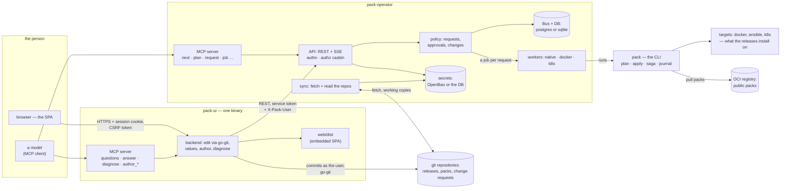
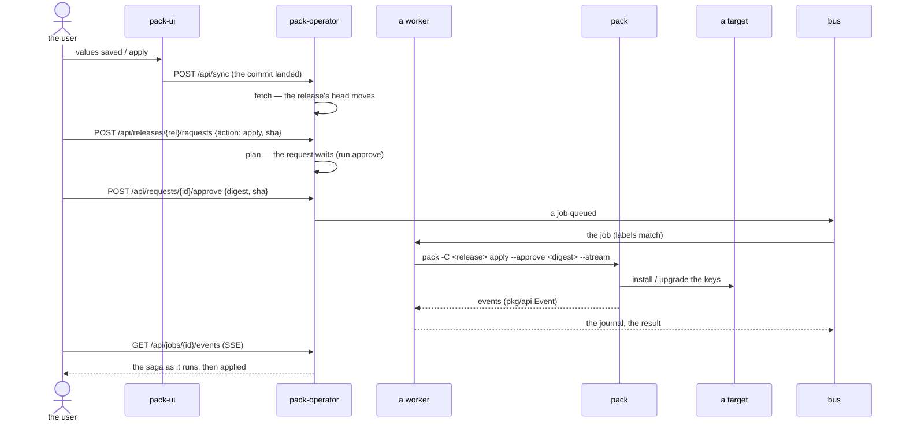
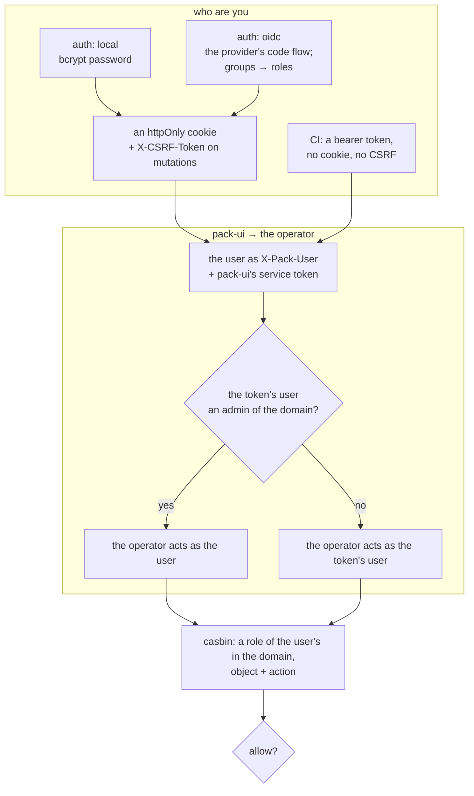

# The architecture: pack, pack-operator, pack-ui

Three processes, each with one job:

- **pack** — the deploy engine. A CLI that knows how to plan a release and apply it (the saga, the journal,
  the state store), how to render values against a pack, how to talk to the targets. It holds no users and
  no API: everything it says is a `--json` document on stdout (`pkg/api`, К1), everything it needs is the
  release's directory and the environment.
- **pack-operator** — the fleet's head. Watches the git repositories of the projects, queues the deploy
  requests, has them approved, runs them as jobs on its workers (each job is a `pack` process), and keeps
  the rights (casbin), the sessions, the secrets and the audit. Its API is REST + SSE (К4); a model
  reaches it through its MCP server.
- **pack-ui** — the person's window. A single binary: the SPA (embedded) and its backend, which edits the
  repositories as the user (go-git, no git binary), proxies the operator's API under the session's
  identity, and serves the values, environment, authoring and diagnosis work. It holds no rights of its
  own — the operator's policy decides every call.

## The whole picture

## Who holds what

|                              | pack                         | pack-operator                                   | pack-ui                                   |
|------------------------------|------------------------------|-------------------------------------------------|-------------------------------------------|
| the deploy itself            | plan, apply, saga, journal   | —                                               | —                                         |
| the state of an installation | the state store (file/DB)    | reads it (К2)                                   | —                                         |
| the repositories             | —                            | fetches, locks, merges (go-git)                 | edits and commits as the user (go-git)    |
| the queue                    | —                            | requests → approvals → jobs (Bus)               | asks for them through the API             |
| the rights                   | —                            | casbin RBAC with domains (К7)                   | none — every call goes to the operator    |
| the users                    | —                            | local + OIDC, sessions, API tokens              | own sessions; the user forwarded by token |
| the secrets                  | reads via the environment    | OpenBao or the encrypted DB store               | names and keys only — never a value       |
| the models                   | —                            | MCP: run a release (no approval tool)           | MCP: values and authoring (no approval)   |

## A deploy, end to end

The operator's flow (К3): a request is idempotent, a plan waits for a person's approval where the policy
says so, a job is one `pack` process on a worker, the events stream back into the Bus.

## Authentication (stage 3, К7)

What is a person's stays a person's: neither MCP server has an approve or a merge tool; a secret's value
is never read over any API; with `auth: none` the dev user is an admin everywhere — a mode that is only
ever switched on explicitly and is announced in the log at start.
